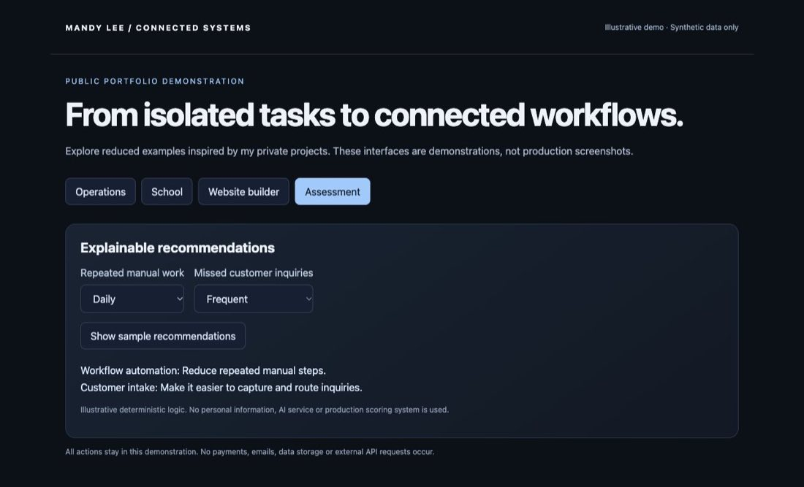

# Interactive Assessments & Smaller Tools

Guided decision tools and tailored reports

## Problem

A generic form captures answers but does little to help a person understand which next step fits their circumstances.

## What I built

Guided assessments turn user inputs into relevant recommendations and reports, with access controls where the experience requires payment or an approved access code.

## Capabilities

- Remote earning questionnaire and personalized report flow
- Payment and access-code authorization
- Report refinement from additional context
- Website and automation readiness assessment
- Weighted recommendations and printable results
- Optional personal review request

## Connected workflow

```text
Answers → input validation → authorized report request → personalized report → refinement
Readiness questions → fit result → recommendations → optional review
```

## Implementation

JavaScript, Express, Stripe, server-side report integration, HTML assessment interfaces.

## Status and boundaries

The remote earning assessment is an implemented tool. Its production provider availability is not tested by this portfolio. Demonstration recommendations are deterministic sample logic, not AI-generated advice or the proprietary production scoring system.

No private assessment answers, access codes, payment data or proprietary report prompts are distributed.

## Demonstration

[Run the sample-data demonstration](../../demo/index.html) and review the [representative code](../../examples/README.md). The demo is an illustrative reconstruction, not a screenshot of the production application.

## Sample-data screen



This is a capture of the runnable portfolio demo, not a production application screenshot.
