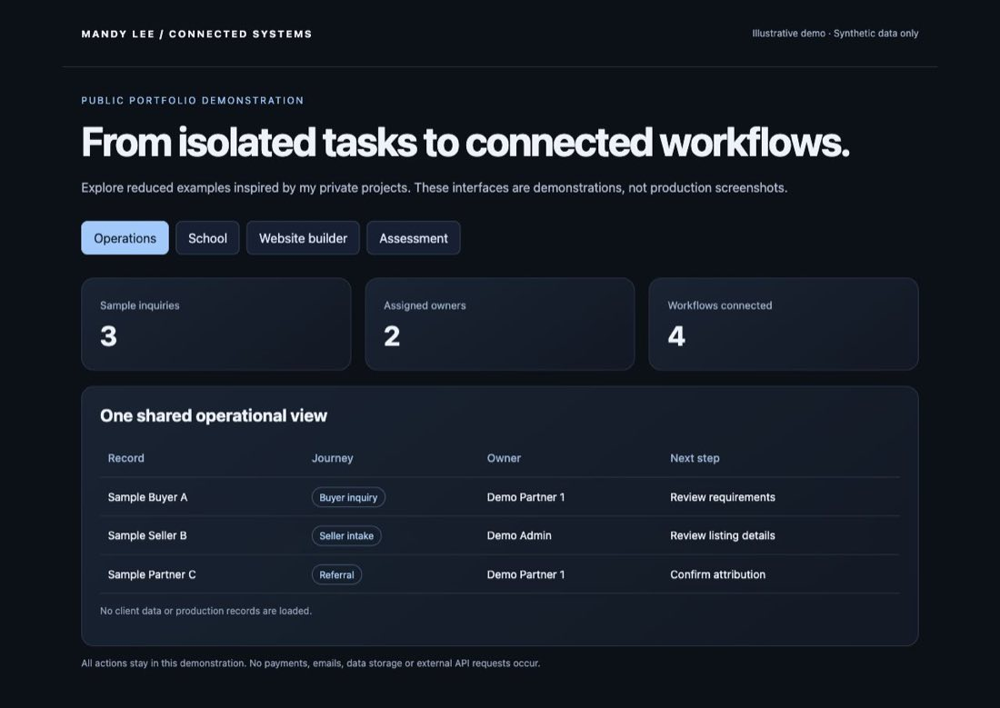

# Selling Freedom OS

Bilingual real estate operating system

## Problem

An international property business needs a shared context across prospects, clients, listings, referral partners and operational teams.

## What I built

A bilingual operating system connects the public property experience to a CRM, role-specific portals, dashboards and business workflows.

## Capabilities

- Buyer, seller and landlord portals
- Admin, partner and affiliate dashboards
- Affiliate system and referral partner network
- Property listings and client intake
- Lead ownership and follow-up planning
- Agreements and document workflows
- Connected project sections including Toucan Grove

## Connected workflow

```text
Property inquiry → shared contact record → assigned owner → follow-up
Seller intake → listing details → agreement → broker access
Partner referral → attribution → commission administration
```

## Implementation

Next.js, React, TypeScript, PostgreSQL, Drizzle, Supabase storage, transactional email.

## Status and boundaries

This is a complex, actively used business system. Development continues alongside day-to-day use as workflows evolve and new capabilities are added.

The source contains both deployed functionality and ongoing local work. Exact live availability varies. The examples contain no production clients, addresses, financial records or access credentials.

Public pages can be explored directly. Private operational views use synthetic data in this portfolio.

[Visit the public website](https://sellingfreedom.mx/)

## Demonstration

[Run the sample-data demonstration](../../demo/index.html) and review the [representative code](../../examples/README.md). The demo is an illustrative reconstruction, not a screenshot of the production application.

## Sample-data screen



This is a capture of the runnable portfolio demo, not a production application screenshot.
