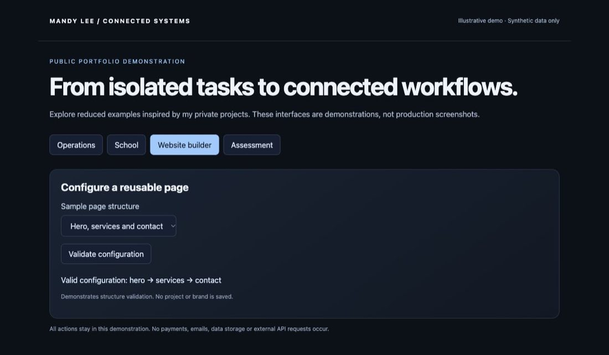

# Madd Hatter Site Studio

Custom website builder

## Problem

Building client websites repeatedly requires consistent branding, reusable structures and a manageable editing workflow.

## What I built

An internal website studio combines curated templates, brand kits, project management and page editing in one workspace.

## Capabilities

- Template catalog with category filtering
- Brand kits and reusable design settings
- Page and section management
- Localized content editing
- Live preview and media selection
- Saved projects and project status

## Connected workflow

```text
Choose template → configure project → apply brand → edit pages → preview → save
```

## Implementation

React, TypeScript, Vinext, Cloudflare, Drizzle.

## Status and boundaries

Internal tool in active development. Features listed were found in source. Automated publication, arbitrary prompt generation and complete export workflows are not claimed here.

The private studio is not linked publicly. A synthetic editor demonstration is included instead.

## Demonstration

[Run the sample-data demonstration](../../demo/index.html) and review the [representative code](../../examples/README.md). The demo is an illustrative reconstruction, not a screenshot of the production application.

## Sample-data screen



This is a capture of the runnable portfolio demo, not a production application screenshot.
