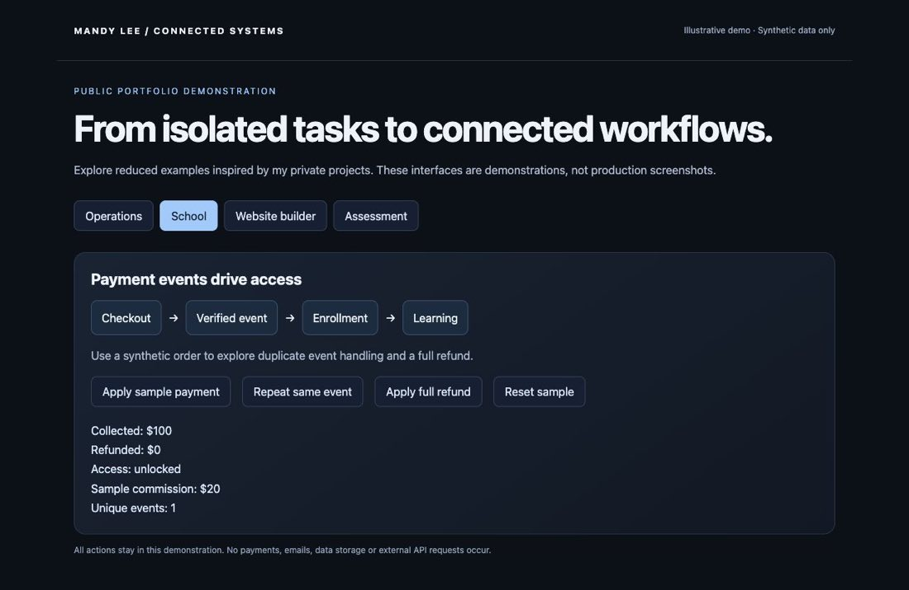

# Trinity School & Ecosystem

Education platform and connected business systems

## Problem

Course sales, student access and referral accounting become difficult to manage when each lives in a separate tool.

## What I built

A custom school connects course discovery, checkout, enrollment, learning progress and affiliate administration.

## Capabilities

- Course catalog and curriculum editing
- Separate purchaser and learner accounts
- Payment verification and enrollment access
- Lesson completion and course access controls
- Affiliate attribution and configurable commissions
- Refund workflows and manual payout records

## Connected workflow

```text
Course discovery → checkout → verified payment → enrollment → learning
Referral → attribution → commission calculation → review → payout record
```

## Implementation

React, TypeScript, Cloudflare Workers, D1, Stripe.

## Status and boundaries

This is a complex, actively used business system. Development continues alongside day-to-day use as workflows evolve and new capabilities are added.

School implementation is present in the reviewed source. This portfolio does not certify current live payment or email delivery. Affiliate payouts are reviewed and recorded manually.

The public link opens the Trinity website. The private school dashboards are represented here with synthetic examples.

[Visit the public website](https://www.trinityprotocol.ai/)

## Demonstration

[Run the sample-data demonstration](../../demo/index.html) and review the [representative code](../../examples/README.md). The demo is an illustrative reconstruction, not a screenshot of the production application.

## Sample-data screen



This is a capture of the runnable portfolio demo, not a production application screenshot.
